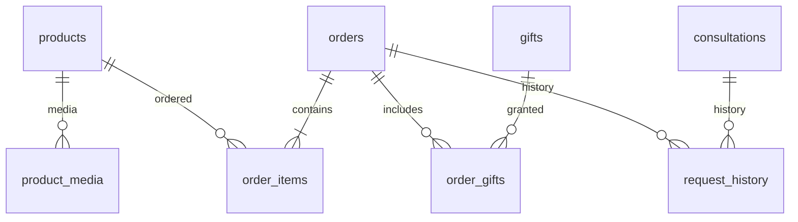

# Cơ sở dữ liệu landing page CLB Toán Cô Lê Nga

Dự án dùng **một database SQLite gồm 15 bảng liên kết**, phù hợp với landing page chạy trên một máy chủ Node.js. Không cần cài MySQL/PostgreSQL hoặc thư viện npm ngoài. Database thực tế nằm ở `data/landing.sqlite`, được tạo bằng `npm run db:init` hoặc tự động khi `npm start`.

## Phạm vi đã thực hiện

| Chức năng | Dữ liệu / xử lý |
| --- | --- |
| Danh mục sách | 10 sách, giá VND, lớp, tập, mô tả, ảnh bìa thật, trạng thái bán |
| Trang mẫu | Đường dẫn PDF; hiện là bản minh họa chung có sẵn, chưa phải nội dung riêng từng cuốn |
| Đặt sách COD | Chọn nhiều cuốn và số lượng, tính giá trên server, lưu thông tin phụ huynh và địa chỉ |
| Nhận tư vấn | Lưu họ tên, điện thoại, lớp, ghi chú; không cần địa chỉ hoặc chọn sách |
| Quà tặng | Danh mục 3 quà và bản chụp quà đi kèm từng đơn |
| Giới thiệu, tác giả, liên hệ | JSON trong `site_content`, được frontend đọc qua API |
| FAQ, phụ huynh, thành tích | Bảng riêng; giữ nhãn case tổng hợp ẩn danh của trang ban đầu |
| Quản trị | Trang `/admin` có đăng nhập để đọc và xử lý đơn/tư vấn; API vẫn hỗ trợ Bearer token để tích hợp |

Các phần trang trí, menu, cuộn trang, chế độ di động và mở FAQ vẫn được xử lý ở frontend. Dự án chưa có cổng thanh toán online, tự gửi email/Zalo hoặc hệ thống vận chuyển. Video, nhóm Zalo và bộ đề mới có dữ liệu quà tặng; cần bổ sung tài nguyên thật vào `gifts.resource_url` và quy trình cấp quyền nếu muốn phát tài nguyên tự động. URL tài nguyên quà tặng không được trả về API công khai.

## Các bảng

| Bảng | Mục đích |
| --- | --- |
| `schema_versions` | Ghi phiên bản schema; hiện tại v2 |
| `products` | Danh mục, giá nguyên VND, lớp, tập, thứ tự, trạng thái bán |
| `product_media` | Ảnh bìa và PDF mẫu; mỗi sách tối đa một media mỗi loại |
| `site_content` | Nội dung `hero`, `author`, `contact`, `sales_policy` dạng JSON |
| `gifts` | Quà tặng, tài nguyên nội bộ, trạng thái và thứ tự |
| `faqs` | Câu hỏi, trả lời, trạng thái và thứ tự |
| `testimonials` | Trích dẫn phụ huynh, ngữ cảnh, nhãn tổng hợp và trạng thái công bố |
| `achievements` | Mốc điểm/thành tích, mô tả, nhãn tổng hợp và trạng thái công bố |
| `orders` | Phụ huynh, địa chỉ, tổng tiền, COD, trạng thái, mã chống gửi trùng |
| `order_items` | Sách trong đơn, tên/đơn giá tại thời điểm đặt, số lượng |
| `order_gifts` | Tên và ID quà được ghi nhận tại thời điểm đặt |
| `consultations` | Yêu cầu tư vấn và trạng thái liên hệ |
| `request_history` | Lịch sử trạng thái đơn hàng/yêu cầu tư vấn |
| `admin_users` | Tài khoản quản trị và mật khẩu đã băm |
| `admin_sessions` | Hash token phiên, CSRF token, hạn phiên và hoạt động gần nhất |



Không tách hồ sơ phụ huynh thành tài khoản đăng nhập: landing page cho phép đặt hàng trực tiếp, mỗi yêu cầu giữ thông tin riêng. Mã đơn là UUID; dữ liệu cá nhân chỉ có trong API quản trị.

## 10 sách và giá mẫu

| ID | Sách | Giá / cuốn |
| --- | --- | ---: |
| `toan-6-tap-1` | Phân dạng Toán 6 tập 1 | 119.000đ |
| `toan-6-tap-2` | Phân dạng Toán 6 tập 2 | 119.000đ |
| `toan-7-tap-1` | Phân dạng Toán 7 tập 1 | 129.000đ |
| `toan-7-tap-2` | Phân dạng Toán 7 tập 2 | 129.000đ |
| `toan-8-tap-1` | Phân dạng Toán 8 tập 1 | 139.000đ |
| `toan-8-tap-2` | Phân dạng Toán 8 tập 2 | 139.000đ |
| `toan-9-tap-1` | Phân dạng Toán 9 tập 1 | 149.000đ |
| `toan-9-tap-2` | Phân dạng Toán 9 tập 2 | 149.000đ |
| `70-de-vao-6` | 70 đề bứt tốc thi vào lớp 6 Chất lượng cao | 179.000đ |
| `200-bai-hinh-vao-6` | 200 bài hình học thi vào lớp 6 Chất lượng cao | 159.000đ |

Tám ảnh PNG `Phan dang toan lop{6..9} t{1..2}.png` và hai ảnh JPG được gắn từ `public/assets/books`. URL có khoảng trắng đã được mã hóa. Giá do dự án đề xuất theo yêu cầu, không phải giá xác nhận của CLB. Chính sách mẫu giữ COD, miễn phí vận chuyển và 3 quà đi kèm từ landing page ban đầu; không dùng ưu đãi bộ 3 cuốn 299.000đ cũ.

## API công khai

| Method | Endpoint | Mục đích |
| --- | --- | --- |
| GET | `/api/landing` | Sách, nội dung trang, FAQ, quà, chia sẻ và thành tích đã công bố |
| GET | `/api/products` | Các sách đang bán |
| POST | `/api/orders` | Lưu đơn COD |
| POST | `/api/consultations` | Lưu yêu cầu tư vấn |

Hai API POST yêu cầu header `Idempotency-Key`: chuỗi gồm chữ/số/dấu gạch ngang, dài 16–100 ký tự. Frontend tự tạo và giữ cùng mã khi gửi lại cùng nội dung sau lỗi mạng. Cùng mã và cùng nội dung trả về bản ghi cũ; cùng mã nhưng nội dung khác trả HTTP 409. Khóa này áp dụng riêng cho đơn hàng và tư vấn, không chống mọi trường hợp khách tự tạo đơn mới.

Ví dụ body đặt hàng:

```json
{
  "name": "Nguyễn Thị An",
  "phone": "0989066885",
  "grade": 6,
  "address": "02 Geleximco, Hà Nội",
  "note": "Gọi trước khi giao",
  "items": [
    { "product_id": "toan-6-tap-1", "quantity": 1 },
    { "product_id": "toan-6-tap-2", "quantity": 1 }
  ]
}
```

Tư vấn dùng cùng `name`, `phone`, `grade`, `note`, bỏ `address` và `items`. Lớp từ 2–9; số điện thoại di động Việt Nam được chuẩn hóa đầu `+84` thành `0`; mỗi sách số lượng 1–20. Server không sử dụng đơn giá/tổng tiền do khách gửi. Đơn cùng chi tiết sách, quà và lịch sử được ghi trong một transaction. Form chỉ báo thành công sau khi server xác nhận lưu.

## API quản trị

Trang quản trị dùng phiên đăng nhập qua cookie; xem [ADMIN.md](ADMIN.md) để tạo tài khoản. Tích hợp API có thể dùng biến môi trường `ADMIN_API_TOKEN` dài ít nhất 32 ký tự và header `Authorization: Bearer <token>`. Không có phiên hoặc token hợp lệ trả 401. Không đưa Bearer token vào frontend.

| Method | Endpoint | Body / kết quả |
| --- | --- | --- |
| GET | `/api/admin/products` | Bao gồm sách đã ẩn |
| PATCH | `/api/admin/products/:id` | `title`, `description`, `price_vnd`, `active`, `cover_url`, `sample_url` |
| GET | `/api/admin/orders?limit=25&offset=0` | Đơn hàng, chi tiết sách/quà, tổng số bản ghi |
| PATCH | `/api/admin/orders/:id/status` | `{ "status": "confirmed" }` |
| GET | `/api/admin/consultations?limit=25&offset=0` | Yêu cầu tư vấn và tổng số bản ghi |
| PATCH | `/api/admin/consultations/:id/status` | `{ "status": "contacted" }` |
| GET | `/api/admin/content` | Nội dung trang và các danh sách kể cả dữ liệu ẩn |
| PATCH | `/api/admin/content/:key` | Các thuộc tính có sẵn của `hero`, `author`, `contact`, `sales_policy` |
| PATCH | `/api/admin/faqs/:id` | `question`, `answer`, `active`, `sort_order` |
| PATCH | `/api/admin/gifts/:id` | `title`, `description`, `resource_url`, `active`, `sort_order` |
| PATCH | `/api/admin/testimonials/:id` | `quote`, `display_name`, `context`, `is_composite`, `published`, `sort_order` |
| PATCH | `/api/admin/achievements/:id` | `metric`, `title`, `description`, `is_composite`, `published`, `sort_order` |

Các trường `active`, `published`, `is_composite`, `gifts_with_order` nhận boolean JSON; `price_vnd`, `shipping_vnd`, `sort_order` là số nguyên. Ảnh/tài nguyên nhận URL HTTPS hoặc `/assets/...`; `null` xóa media hoặc tài nguyên quà. API hiện sửa các bản ghi có sẵn; thêm dữ liệu mới bằng SQL có kiểm soát.

Trạng thái đơn: `pending → confirmed → shipping → completed`; có thể `cancelled` khi đang `pending`/`confirmed`. Tư vấn: `new → contacted → resolved`; có thể `cancelled` khi đang `new`/`contacted`. Trạng thái cuối không mở lại. Đổi trạng thái đồng thời lưu lịch sử trong transaction.

Ví dụ PowerShell, sau khi đã cấu hình token trong phiên shell:

```powershell
$headers = @{ Authorization = "Bearer $env:ADMIN_API_TOKEN" }
Invoke-RestMethod 'http://localhost:3000/api/admin/orders' -Headers $headers
Invoke-RestMethod 'http://localhost:3000/api/admin/products/toan-6-tap-1' `
  -Method Patch -Headers $headers -ContentType 'application/json' `
  -Body '{"price_vnd":125000}'
```

## Lưu trữ và triển khai

`DATABASE_PATH` cho phép thay đường dẫn database. Dùng một ổ lưu trữ bền vững khi deploy; database phải còn sau khi tiến trình khởi động lại. `data/` và `.env` đã được đưa vào `.gitignore`, và server chỉ phục vụ các file frontend công khai cùng assets, không phục vụ file SQLite/source backend.

Sao lưu SQLite bằng công cụ hỗ trợ online backup, hoặc dừng server trước khi sao lưu thư mục `data/`; SQLite đang dùng WAL nên không chỉ chép riêng file `.sqlite` khi server đang ghi. Database này hướng tới một server ứng dụng; khi cần nhiều server ghi cùng lúc, nên chuyển sang PostgreSQL. Chạy init/seed lại không ghi đè giá, nội dung, media hay trạng thái đã chỉnh sửa. Schema v2 bổ sung hai bảng quản trị qua `database/admin-schema.sql`; các thay đổi schema sau này cần migration riêng.
